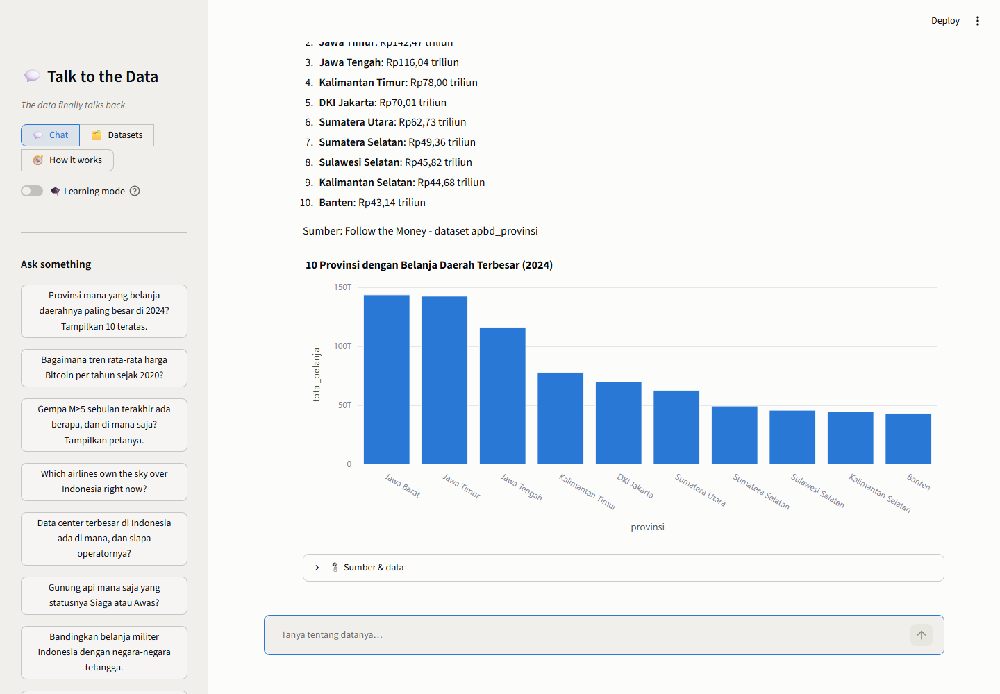
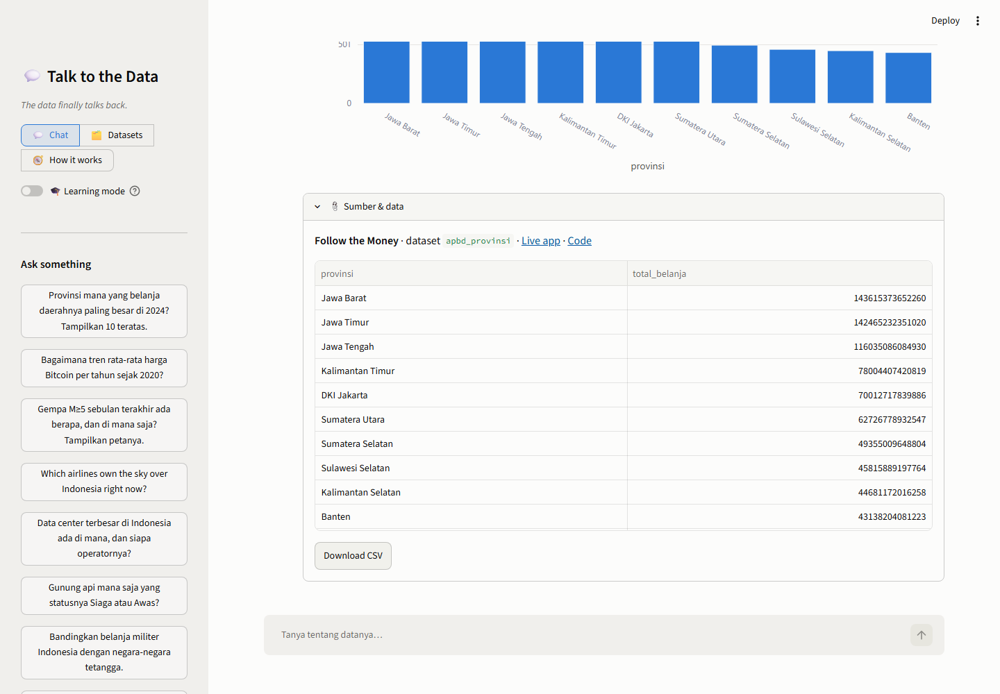
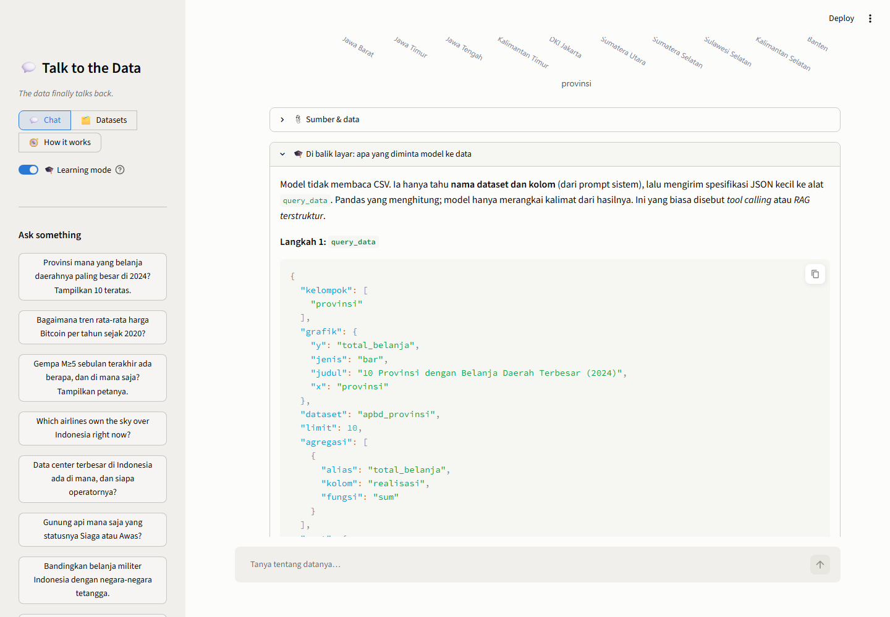
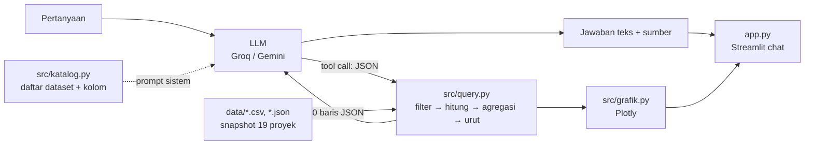

# 💬 Talk to the Data

> **The data finally talks back.**
> Chatbot yang menjawab pertanyaan bahasa sehari-hari dari data 19 proyek portofolio ini: APBD 38 provinsi,
> harga Bitcoin dan transaksi paus-nya, gempa dan gunung api, pesawat di langit Indonesia, kapal di Selat
> Malaka, satelit yang melintas, titik api dan hutan yang hilang, polusi udara Jabodetabek, upah minimum vs
> harga rumah, konflik bersenjata dunia, pemutusan internet di seluruh dunia, hoaks yang dibantah pemeriksa fakta, siapa saja pemakai Palantir di dunia dan berapa kontrak pemerintah yang mereka menangkan, saham Palantir saat perang pecah, pusat data, kabel internet bawah laut, dan geografi pertahanan. Setiap jawaban dihitung dari
> data lewat query terstruktur, lalu disajikan
> sebagai teks, grafik Plotly, dan tabel sumbernya. Dibangun dengan Python, pandas, Plotly, dan Streamlit di
> atas API LLM tier gratis (Groq atau Gemini).

## 🇬🇧 In English

**The data finally talks back.** One chatbot over nineteen open-data projects. Ask in plain Indonesian or English; a large language model turns the question into a small structured query, pandas runs it, Plotly draws it, and the answer comes back with the exact rows it was built from. No made-up numbers: if the data can't answer, it says so.

- **Ask** about budgets, Bitcoin, earthquakes, ships, satellites, air quality, conflicts, hoaxes, Palantir's customers, contracts, and war-time stock moves, and more.
- **Verify** every answer: the source project, dataset, and result table are one click away.
- **Query** 53 datasets without any API key using the built-in query builder.
- **Inspect** the tool-calling loop in learning mode, including failed attempts and how they were fixed.

**Built with:** Python, pandas, Plotly, Folium, Streamlit, LLM tool calling (Groq or Gemini free tier)  
**Data:** The 53 datasets of the other portfolio projects  
**Engineering:** Answers are computed by a structured pandas query engine, never by the model itself. pytest suite with CI on GitHub Actions

*The rest of this README is in Indonesian.*

**🚀 Coba langsung di browser:** [talk-to-the-data.streamlit.app](https://talk-to-the-data.streamlit.app)



## Kenapa project ini ada?

Enam dashboard sebelumnya punya satu kelemahan yang sama: pengunjung harus tahu di mana tombolnya. Pertanyaan
sederhana seperti "provinsi mana yang belanjanya paling besar?" butuh membuka aplikasi yang tepat, memilih tab
yang tepat, lalu menggeser slider yang tepat. Project ini membalik arahnya: pengunjung bertanya, aplikasi yang
mencari.

Tantangan teknisnya menarik justru karena model bahasa **tidak boleh dipercaya begitu saja**:

1. Model tidak boleh mengarang angka. Semua angka harus datang dari pandas, bukan dari ingatan model.
2. Model tidak boleh menjalankan kode bebas di server publik. Ia hanya boleh mengisi formulir JSON yang
   sudah dibatasi (filter, kelompok, agregasi), dan aplikasi yang menjalankannya.
3. Semuanya harus muat di tier gratis: prompt sistem ringkas, riwayat dibatasi, hasil query dipotong.

## Fitur

| Bagian | Isi |
|---|---|
| 💬 Chat | Tanya dalam bahasa Indonesia atau Inggris. Jawaban = teks + grafik (bar, line, scatter, pie, peta) + expander **Sumber & data** berisi proyek asal, dataset, tabel hasil query, dan tombol download CSV |
| 🗂️ Datasets | Ringkasan 53 dataset dari 19 proyek (baris, kolom, rentang waktu) dan **query builder** yang memakai mesin yang sama dengan chatbot, tanpa API key |
| 🧭 How it works | Alur tool calling, potongan kode intinya, dan daftar keterbatasan |
| 🎓 Learning mode | Toggle di sidebar: tiap jawaban menampilkan JSON yang dikirim model ke alat, hasil yang dikirim balik, dan percobaan yang gagal lalu diperbaiki |

Sidebar: sembilan belas pertanyaan contoh sekali klik, pilihan provider (Groq atau Gemini), API key untuk sesi
saat ini bila secrets kosong, dan tombol Clear chat.




## Cara menjalankan

```bash
git clone https://github.com/Avalon2222/talk-to-the-data.git
cd talk-to-the-data
python -m venv .venv && source .venv/bin/activate   # Windows: .venv\Scripts\activate
pip install -r requirements.txt
cp .streamlit/secrets.toml.example .streamlit/secrets.toml   # lalu isi api_key
streamlit run app.py
```

API key gratis, tanpa kartu kredit: [Groq](https://console.groq.com/keys) (bawaan, model
`llama-3.3-70b-versatile`) atau [Google Gemini](https://aistudio.google.com/apikey) (`gemini-3.5-flash-lite`).
Tanpa secrets, key juga bisa diisi di sidebar untuk satu sesi. Halaman Datasets jalan tanpa key sama sekali.

Buka `http://localhost:8501`. Jalankan tes dengan `python -m pytest tests/ -v` (90 tes, tanpa internet,
tanpa API key; otomatis jalan di GitHub Actions setiap push dan pull request).

Memperbarui snapshot data dari semua repo (butuh internet):

```bash
python scripts/sinkron_data.py                 # unduh dari GitHub
python scripts/sinkron_data.py --lokal ..      # atau salin dari clone lokal di folder induk
```

## Cara kerja (ringkas)



Inti loop-nya ada di `src/llm.py`:

```python
for putaran in range(MAKS_PUTARAN):
    pesan = klien.chat(messages, tools=alat.definisi)       # model: teks, atau minta memanggil alat
    if not pesan.get("tool_calls"):
        return Jawaban(pesan["content"], langkah)           # jawaban akhir
    for p in pesan["tool_calls"]:
        teks, lampiran = alat.jalankan(p["function"]["name"], json.loads(p["function"]["arguments"]))
        messages.append({"role": "tool", "tool_call_id": p["id"], "content": teks})
```

Dan satu contoh "formulir" yang diisi model untuk pertanyaan *provinsi mana yang belanja daerahnya paling
besar di 2024*:

```json
{"dataset": "apbd_provinsi",
 "filter": [{"kolom": "akun", "op": "==", "nilai": "Belanja Daerah"}, {"kolom": "tahun", "op": "==", "nilai": 2024}],
 "kolom": ["provinsi", "realisasi"], "urut": {"kolom": "realisasi", "turun": true}, "limit": 10,
 "grafik": {"jenis": "bar", "x": "provinsi", "y": "realisasi", "judul": "Realisasi belanja daerah 2024"}}
```

Kalau formulirnya salah (kolom tidak ada, rumus ditolak), pesan galatnya dikirim balik ke model dan model
memperbaiki sendiri. Penjelasan lengkap di [docs/BELAJAR.md](docs/BELAJAR.md).

## Contoh pertanyaan

- Provinsi mana yang belanja daerahnya paling besar di 2024? Tampilkan 10 teratas.
- Bagaimana tren rata-rata harga Bitcoin per tahun sejak 2020?
- Gempa M≥5 sebulan terakhir ada berapa, dan di mana saja? Tampilkan petanya.
- Which airlines own the sky over Indonesia right now?
- Gunung api mana saja yang statusnya Siaga atau Awas?
- Berapa BTC yang dipindahkan paus per hari, dibagi menurut pola transaksi?
- Berita kategori apa yang paling sering muncul di hari-hari Bitcoin paling liar?
- Di kota mana upah minimum paling lama untuk beli rumah seken, kalau nabung 30% gaji?
- Provinsi mana yang paling banyak titik apinya minggu ini?
- Which countries had the most conflict deaths in 2025?
- Bagaimana tren kapal yang melintasi Selat Malaka per bulan sejak 2019?
- Negara mana yang punya satelit militer paling banyak?
- Kawasan mana di Jabodetabek yang rata-rata PM2.5-nya paling tinggi?

## Struktur folder

```
talk-to-the-data/
├── app.py                     # tampilan Streamlit: chat, Datasets, How it works
├── src/
│   ├── katalog.py             # daftar proyek, dataset, arti kolom, pemuat data
│   ├── query.py               # query terstruktur di atas pandas (filter, hitung, agregasi, urut)
│   ├── grafik.py              # spesifikasi grafik → Plotly
│   ├── alat.py                # definisi tool (JSON schema) + prompt sistem
│   ├── llm.py                 # klien API kompatibel OpenAI + loop tool calling
│   ├── maskapai.py            # callsign → maskapai (dari who-owns-the-sky)
│   ├── mmsi.py                # MMSI → negara bendera, kode tipe kapal (dari strait-watch)
│   └── wilayah.py             # titik → provinsi, ray casting numpy (dari burning-archipelago)
├── data/<id-proyek>/          # snapshot CSV/JSON dari tiap repo (lihat data/SUMBER_DATA.md)
├── scripts/sinkron_data.py    # perbarui snapshot dari GitHub atau clone lokal
├── tests/                     # pytest, tanpa internet, tanpa API key
└── docs/
    ├── BELAJAR.md             # panduan 10 langkah: tool calling dari nol
    ├── LATIHAN.md             # 9 latihan bertingkat
    └── screenshots/
```

## Keterbatasan

- **Snapshot, bukan data langsung.** Gempa, pesawat, dan paus Bitcoin adalah potret saat data disalin dari
  repo asalnya. Untuk data langsung, buka aplikasi masing-masing proyek.
- **Model bisa salah memilih kolom atau filter.** Expander *Sumber & data* ada supaya pembaca bisa mengecek
  query yang benar-benar dijalankan, bukan hanya kalimat jawabannya.
- **Query terstruktur punya batas.** Tidak ada join antar dataset, regresi, atau teks bebas. Latihan 7 di
  [docs/LATIHAN.md](docs/LATIHAN.md) membahas cara menambahnya.
- **Tier gratis dibatasi** per menit dan per hari. Saat kena batas, aplikasi menampilkan saran tunggu.
- **Bukan saran investasi.** Jawaban soal Bitcoin hanya membaca data historis.

## Lisensi

MIT. Data mengikuti lisensi sumber masing-masing proyek (lihat [data/SUMBER_DATA.md](data/SUMBER_DATA.md)).
